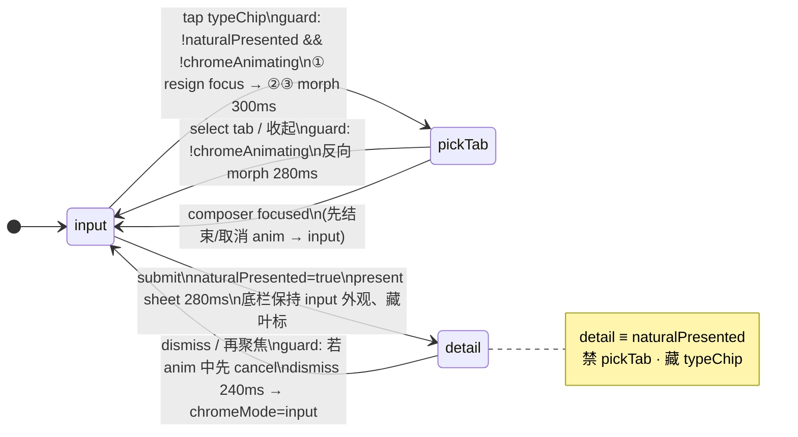

# Mimi 今天页 · 底栏一行双态 · 专业交互规范（IX v2）

> **状态**：用户已点头；落地分支 `design/composer-ix-v2`（`#149` / `design/composer-presence-layout` 仅作参考）。**不合 main**；真机过审前不装半成品。
>
> **审稿人**：三角（可实现性已过）→ 用户点头（已）→ 代码落地（本分支）→ 三角审 draft → DeviceTrial。
>
> **关联布局方案**：见同目录 [OPTIONS.md](./OPTIONS.md)（毛绒 A 角落露头已定；本文件只管底栏 chrome 交互与动效）。

---

## 1. Goals / Non-goals

### Goals

1. 底栏 **永远一行**（禁止 composer 上 + tab 下两排）。
2. 三态清晰可预期：`.input` | `.pickTab` | `.detail`，过渡有「叶标 ↔ 三 tab」同高 morph，不再整块闪切。
3. **过渡不可重入**：动画进行中忽略叶标 / tab / 收起连点。
4. 键盘 / 焦点与 sheet 关系明确：进 pickTab **先失焦再 morph**；聚焦输入强制离 detail。
5. 毛绒角落露头不挡手、不参与 hit-test。
6. 规范足够精确，三角可对现有 `safeAreaInset` + `dualChrome` 壳说 yes/no。

### Non-goals

- 不改认娃 / 档案 Model / ConfirmCard 语义。
- 不发明第四态（除非后续证明绝对必要；本版 **prefer not**）。
- 不把 detail 强行改成同区卡（draft 可继续用 `ParentingNaturalSheet`；动效统一 spring 即可）。
- 不合并 main；不部署。
- 规范阶段不写 Swift；落地在 `design/composer-ix-v2`。

### 相对 #149 的问题（为何整套重做）

|#149 现状|用户感受|本规范对策|
|---|---|---|
|`dualChrome` 整块 `switch` + `.snappy(0.22)`|跳、闪切|同高 capsule morph + matchedGeometry|
|无 `chromeAnimating`|连点乱态|过渡锁，结束再接事件|
|进 pickTab 未先收键盘|键盘顶动画|①失焦 ≤50ms → ②③ morph|
|detail 默认 sheet 硬切感|突兀|present/dismiss 统一 spring|
|叶标在 detail 下曾可点（后修）|互斥不稳|detail ≡ `naturalPresented`，开着禁 pickTab、藏叶标|

---

## 2. 状态机

### 2.1 硬约束（三角 · 不可破）

| ID | 规则 |
|----|------|
| H1 | 态 **仅** `.input` \| `.pickTab` \| `.detail`。`detail` 开着 ≡ `naturalPresented == true`。 |
| H2 | **互斥**：`detail` 时禁止进入 `pickTab`、隐藏 typeChip（叶标）。 |
| H3 | **聚焦输入** → 强制离开 detail（dismiss）→ `chromeMode = .input`。 |
| H4 | **`chromeAnimating == true`** 期间：忽略叶标 / tab / 收起（及任何会改 `chromeMode` 的手势）。动画结束再接事件。 |
| H5 | 进 `pickTab`：**先** resign focus / 收键盘，**再** morph。 |
| H6 | detail present / dismiss 用 **同一套 spring**；禁止系统默认硬切感。若 pickTab 动画进行中又要 dismiss detail： **先 cancel 动画**，再 dismiss。 |
| H7 | **我们家**：仅一排 `tabBar`，**无** composer morph（`showsComposer == false`）。 |
| H8 | 不合 main。 |

### 2.2 Mermaid



### 2.3 过渡表

| from → to | 触发 | Guard | 动画（见 §4 时序表，数字勿改） |
|-----------|------|-------|--------------------------------|
| input → pickTab | 点叶标 `typeChip` | `!naturalPresented && !chromeAnimating && showsComposer` | 总 **300ms**：①失焦 ≤50；②③并行 250。spring(0.32, 0.86)；RM: 120ms crossfade |
| pickTab → input | 点选中 tab / 点其它 tab 写回 / 点「收起」 | `!chromeAnimating` | 反向 **280ms**，同上曲线 |
| pickTab → input | composer 获得焦点 | —（焦点路径优先收态） | 若 anim 中先 cancel；再回 input（控件已可见路径） |
| input → detail | submit（`canSubmit && !busy`） | `!chromeAnimating`（建议）；设 `naturalPresented=true`，`chromeMode=.detail` | present sheet **280ms** 统一 spring；底栏 **保持 input 外观**、**藏叶标** |
| detail → input | sheet 确认/不记/下拉 dismiss；或再聚焦 composer | 若 `chromeAnimating`：**先 cancel** 再 dismiss | dismiss **240ms** 同上；然后 `chromeMode=.input` |
| * → pickTab | （任何） | **`naturalPresented` 时一律拒绝** | — |
| 我们家 tab | 切到我们家 | — | **仅一排 tab**，无 composer morph |

---

## 3. 分态说明

### 3.1 `.input`（默认）

**布局（一行）**

```
[+] [键/麦] [====== 按住说话 / 输入 ======] [叶标]
```

- 叶标 = 当前 `ParentingTab` 的 SF Symbol 圆芯片（`typeChipSystemImage` / `typeChipTitle`）。
- `detail` 打开时叶标 **不渲染**（`typeChipSystemImage = nil`）。
- 底栏高度：与现有 `ParentingComposerBar` 单行玻璃卡一致（约 44–56pt 内容 + padding）；**不**因态切换改变「槽」的目标高度意图——pickTab 同高 morph。

**Enter**

- 冷启动 / 离开 pickTab / sheet dismiss 后。
- 从 detail 回来：叶标 **fade-in**（随 dismiss 末段或随后 120ms），不要弹入。

**Exit**

- → pickTab：见路径 A。
- → detail：submit；叶标立刻隐藏（可与 sheet present 同帧），composer 控件 **保留**（底栏不换成 tab）。

**Cancel**

- 无独立 cancel；空白不收（input 是稳态）。

**手势**

| 手势 | 行为 |
|------|------|
| 点叶标 | → pickTab（H4/H5） |
| 点 + / 麦 / 输入 / 发送 | 现有 composer 行为；聚焦走 H3 |
| 拖拽 | 无（底栏本身不拖） |

**键盘 / 焦点**

- 允许键盘。
- `onFocusChange(true)`：若 `naturalPresented` → dismiss → `.input`；若 `.pickTab` → 收回 `.input`。

### 3.2 `.pickTab`

**布局（同区一行，不高出第二排）**

```
[ 今天 ] [ 成长✓ ] [ 我们家 ]     （可选右上「收起」chevron，a11y）
```

- 三 tab 落在 **同一胶囊/玻璃条** 内，条高度与 input 行目标高度一致（同高 morph）。
- 当前 tab 芯片为 matchedGeometry 落点（从叶标展开）。

**Enter**（严格顺序）

1. `chromeAnimating = true`
2. ① Resign focus / 收键盘（≤50ms 预算内完成发起）
3. ②③ 并行：输入控件 opacity→0 + 宽度收拢；叶标 matchedGeometry → 当前 tab 芯片；条 morph 展开三 tab
4. 动画结束 → `chromeAnimating = false`，`chromeMode = .pickTab`

**Exit → input**

1. `chromeAnimating = true`
2. 反向：三 tab morph 回叶标；输入控件 fade/slide 入（280ms）
3. 写回选中 `tab`（若点了非当前项）
4. 结束 → `chromeAnimating = false`，`chromeMode = .input`

**Cancel**

- 「收起」按钮 / 点 **当前已选** tab → 回 input（不改 tab）。
- 内容区空白点击收回：**可后置**（本版不阻塞；#149 已知缺口，v2 实现可二期加 scrim）。

**手势**

| 手势 | 行为 |
|------|------|
| 点某一 tab | 选中并 → input（280ms 反向） |
| 点「收起」 | → input，tab 不变 |
| 点叶标 | N/A（叶标已展开为条） |
| 连点 | H4 忽略 |

**键盘 / 焦点**

- Enter 时已失焦；若用户又以某种方式聚焦 composer（理论上 pickTab 时 composer 已卸），强制 → input。

### 3.3 `.detail`

**语义**：`chromeMode == .detail` **且** `naturalPresented == true`（二者同步；dismiss 时一并清）。

**布局**

- 底栏：**保持 `.input` 外观**（composer 可见），**藏叶标**。
- 上层：`ParentingNaturalSheet`（medium/large detent，draft 可保留）。

**Enter**

- submit → `chromeMode = .detail`；`naturalPresented = true`；sheet present **280ms** 统一 spring。

**Exit**

- 确认 / 不记 / 下拉 dismiss / 再聚焦输入：
  - 若此时误入了其它 chrome 动画：**先 cancel**（H6）
  - sheet dismiss **240ms**
  - `naturalPresented = false`；`chromeMode = .input`
  - 叶标恢复显示

**Cancel**

- 与 Exit 相同（「不记」/ 下拉即 cancel 提案，不写回）。

**手势**

| 手势 | 行为 |
|------|------|
| sheet 内确认 / 不记 | dismiss → input |
| sheet 下拉 | dismiss → input |
| 点底栏输入（聚焦） | H3：dismiss → input |
| 点叶标 | **不可用**（已藏）；若残影被点 → guard 拒绝 |
| 尝试进 pickTab | **禁止**（H2） |

**键盘 / 焦点**

- Sheet 展示期间 composer 一般失焦；一旦 `focused == true` → 走 H3（cancel anim → dismiss → input）。
- **Sheet 中途 drag（detent 拖拽）+ 同时 focus**：以 focus 路径为准——先 cancel chrome anim（若有），再 `naturalPresented = false`，打断 sheet 手势（避免半开 sheet + pickTab 竞态）。

---

## 4. 动效规格与时序表（三角原表 · 数字勿改）

### 4.1 Motion tokens

| Token | 值 | 用途 |
|-------|-----|------|
| `springChrome` | **response 0.32, dampingFraction 0.86** | input↔pickTab morph；detail present |
| `springDismiss` | 同 `springChrome`（统一，禁另一套硬切） | detail dismiss 亦用同一 spring；时长预算见下表 |
| `durationInputToPick` | **300ms** 总 | ①≤50 + ②③并行 250 |
| `durationPickToInput` | **280ms** | 反向 morph |
| `durationDetailPresent` | **280ms** | sheet present |
| `durationDetailDismiss` | **240ms** | sheet dismiss |
| `reduceMotionCrossfade` | **120ms** linear/easeInOut | `accessibilityReduceMotion == true` 时替代 spring morph |
| `chromeAnimating` | Bool | 过渡锁（H4） |

SwiftUI 示意（落地时，非本回合）：

```swift
// 仅文档示意 — 本回合不改代码
Animation.spring(response: 0.32, dampingFraction: 0.86)
// Reduce Motion:
Animation.easeInOut(duration: 0.12)
```

### 4.2 matchedGeometry

| ID（建议） | 谁参与 morph | 备注 |
|------------|--------------|------|
| `parenting.chrome.tabChip` | 输入态 **叶标** ↔ pickTab 态 **当前选中 tab 芯片** | 同一 `Namespace`；仅当前 tab |
| （可选）`parenting.chrome.barSurface` | 玻璃条/胶囊外形同高展开 | 若实现成本高，可先做 chip morph + 条 crossfade；优先 chip |

**不参与 morph**：`+`、语音键、文本框、发送钮、我们家单排 tab、sheet 本身、角落毛绒。

### 4.3 三角时序表（原样并入）

硬规则（再次强调）：

- `chromeAnimating` 期间忽略叶标 / tab / 收起；
- `detail ≡ naturalPresented`，开着禁 pickTab；
- `focused → dismiss detail → input`；
- 进 pickTab 前先失焦 / 收键盘。

| 路径 | 步骤 | 时长 | 曲线 |
|------|------|------|------|
| input→pickTab | ①失焦 ②输入控件 opacity→0 + 宽收 ③叶标 matchedGeometry→当前 tab 芯片，条同高 morph 展开三 tab | 总 **300ms**（①≤50，②③并行 250） | spring(0.32, 0.86)；Reduce Motion：120ms crossfade |
| pickTab→input | 反向：三 tab morph 回叶标，输入控件 fade/slide 入 | **280ms** | 同上 |
| →detail | present sheet（draft 可保留）；底栏保持 input 外观、藏叶标 | present **280ms** | 统一 spring，禁默认硬切 |
| detail→input | 点先不记/确认/下拉/再聚焦：dismiss 后 chromeMode=input | dismiss **240ms** | 同上；若 pickTab 动画中先 cancel |
| 我们家 | 仅一排 tab，无 composer morph | — | — |

手势（三角）：叶标点一下进 pickTab；点选中 tab 或「收起」回 input；内容区空白点收回可后置。

### 4.4 关键路径 A · ms 时间线（input → pickTab → 选 tab → input）

见示意：`ix-timing-input-pickTab.png`

```
t=0       用户点叶标
t=0       guard OK → chromeAnimating=true
t=0–50    ① resignFirstResponder / focused=false（发起）
t=50–300  ② opacity→0 + width collapse（输入控件）
          ③ matchedGeometry 叶标→当前 tab；条 morph 展开三 tab
          （②③并行，250ms）
t=300     chromeAnimating=false；稳态 pickTab

t=300+    用户点「成长」（例）
t=0'      chromeAnimating=true；记录 tab=.growth
t=0'–280' 反向 morph：三 tab→叶标；输入控件 fade/slide 入
t=280'    chromeAnimating=false；chromeMode=.input
```

Reduce Motion：整段改为 120ms crossfade（无 geometry morph）。

### 4.5 关键路径 B · ms 时间线（input → submit → detail → focus/dismiss → input）

见示意：`ix-timing-detail.png`

```
t=0       用户提交（handOver：已会失焦）
t=0       chromeMode=.detail；naturalPresented=true；藏叶标
t=0–280   sheet present（spring 统一）
t=280     sheet 稳态

—— 路径 B1：再聚焦输入 ——
t=0″      focused=true → H3
t=0″      若 chromeAnimating：cancel
t=0″–240″ sheet dismiss
t=240″    naturalPresented=false；chromeMode=.input；叶标恢复

—— 路径 B2：sheet 确认/不记/下拉 ——
同 dismiss 240ms → input
```

**注意**：detail 期间底栏 **不**切到 pickTab，也 **不**做 composer↔tab morph。

---

## 5. 角落毛绒（方案 A，与底栏正交）

| 项 | 规格 |
|----|------|
| 尺寸 | `PlushMascot` size **48pt**；可见裁剪约 `0.55×0.7` frame（与 #149 `cornerPlushSize` 一致可保留） |
| 位置 | 今天页右下，贴底栏上方外侧；不占主列宽 |
| Hit-testing | **关闭**（`.allowsHitTesting(false)`），不挡 + / 麦 / 叶标 |
| 键盘 | 键盘升起时 **不上移放大**；可随 safe area 轻微上推或保持原位（实现二选一，优先「不放大、不挡输入」） |
| 我们家 / 成长 | 可同规或仅今天；不进入 chrome 状态机 |
| 动效 | 不参与 matchedGeometry；进出页可用极轻 opacity，不抢 chrome |

---

## 6. 边缘情况

| 场景 | 期望 |
|------|------|
| 叶标连点 / tab 连点 / 收起连点 | `chromeAnimating` 期间全部忽略 |
| pickTab 中快速选 tab 又点收起 | 第一次有效手势锁动画；结束前忽略后续 |
| 选「我们家」 | 写回 tab 后：若 `showsComposer==false`，chrome **直接**一排 tab，**不做** composer morph（H7）；从有 composer 的 tab 切来时：可先结束 pickTab→input 动画再切内容，或短 crossfade 到 tab-only——**禁止**两排 |
| 从我们家回今天 | 出现 composer 行 + 叶标；可用 120–200ms fade，不做第四态 |
| Reduce Motion | 所有 chrome 过渡 → 120ms crossfade；sheet 仍尽量短 fade，避免大位移 |
| VoiceOver | 叶标 `accessibilityLabel` = 当前 tab 名；pickTab 三按钮标准 traits；anim 锁期间控件 `accessibilityRespondsToUserInteraction` 可保持 true 但 action no-op，或短暂 disable 并在结束时 announce |
| Dynamic Type / accessibility sizes | composer 已有「仅键盘」策略；pickTab 三 tab 可换行否？**否**——保持一行，可缩小字距/用图标+短标签；极端尺寸下允许横滑三 tab，但仍单行槽高 |
| Sheet 拖到一半 + 聚焦输入 | cancel chrome anim → dismiss sheet → input（H3/H6） |
| submit 时已在 pickTab | 不应发生（submit 在 composer）；若草稿路径例外：先 cancel→input 再走 detail |
| 旋转 / 分屏 | Namespace 重建后跳过当次 morph，一次 crossfade 恢复 |

---

## 7. 映射到现有类型（无第四态）

| 概念 | 现有落点 | v2 要求 |
|------|----------|---------|
| `ParentingChromeMode` | `.input` \| `.pickTab` \| `.detail` | **保持三态**；增加运行时 `chromeAnimating`（`@State`，不必进 enum） |
| `naturalPresented` | `@State` + `.sheet` | **≡ detail 打开**；与 `chromeMode == .detail` 同步写入/清除 |
| `dualChrome(for:)` | `ParentingHomeView` | 保留一槽；用 `ZStack`/`matchedGeometryEffect` 做同高切换，**禁止** `VStack{composer; tabBar}` |
| `ParentingComposerBar` | 叶标经 `typeChip*` / `onTypeChipTap` / `onFocusChange` | detail 时 `typeChipSystemImage=nil`；tap 受 H4/H2 guard |
| `pickTabChrome` / `tabBar` | 同区三 tab | 当前 tab 加 matchedGeometry id；加「收起」a11y |
| `ParentingNaturalSheet` | sheet detent | present/dismiss 动画参数统一 spring；不改提案语义 |
| `onComposerFocus` | 已 dismiss + 回 input | 补：**cancel anim 优先**；pickTab 中聚焦同样回 input |
| `cornerPlushPeek` | 48pt clipped | hitTest false；不进状态机 |
| 我们家 | `showsComposer==false` → 只 `tabBar` | **无 composer morph** |

```
chromeMode          naturalPresented    叶标可见    底栏槽内容
.input              false               ✓           ComposerBar(+叶标)
.pickTab            false               —           三 tab（同高）
.detail             true                ✗           ComposerBar（无叶标）+ Sheet
（我们家）           *                   —           仅 tabBar 一排
```

---

## 8. Reduce Motion / VoiceOver 摘要

- `accessibilityReduceMotion`：§4.1 / §4.3 → **120ms crossfade**，不做 matchedGeometry 位移。
- VoiceOver：状态变化后 brief announcement 可选（「已选择成长」）；anim 锁不导致焦点陷阱。
- 不依赖颜色唯一区分选中 tab（保留 ✓ / selected 背景 + accessibility traits）。

---

## 9. DeviceTrial 验收清单（用户点头并落地后）

- [ ] 冷启动今天页：单行底栏 + 叶标；无第二排 tab
- [ ] 点叶标：先键盘收起，再 300ms 级 morph 到三 tab（肉眼无整块闪切）
- [ ] morph 中连点叶标/tab/收起：无乱态、无双动画叠加
- [ ] 点选中 tab 或收起：280ms 回到输入行 + 叶标
- [ ] 点其它 tab：内容切换正确，回到输入态
- [ ] 提交：sheet 280ms 级出现；底栏仍是输入外观；**无叶标**；无法进 pickTab
- [ ] sheet 确认/不记/下拉：240ms 级消失；回 input；叶标恢复
- [ ] sheet 打开时点输入框：sheet 收起并回 input
- [ ] 我们家：仅一排 tab；从今天切去/切回无两排、无错误 morph
- [ ] 角落毛绒不挡点击（点穿到控件）
- [ ] Reduce Motion 开：仅 crossfade，无大位移
- [ ] VoiceOver：叶标与三 tab 可聚焦、可激活

---

## 10. 示意文件

| 文件 | 内容 |
|------|------|
| `ix-state-flow.png` | 三态流转 + 硬约束标注 |
| `ix-timing-input-pickTab.png` | 路径 A 时间条（300 / 280） |
| `ix-timing-detail.png` | 路径 B 时间条（280 present / 240 dismiss） |

路径根：`apps/ios-conversation/docs/composer-presence-layout/`  
镜像：`/workspace/mimi-layout-options/INTERACTION.md`（及同名 png）

---

## 11. 落地顺序（规范过审后）

1. 三角：可实现性 yes/no（现有 `safeAreaInset` 壳）
2. 用户点头
3. 新分支 `design/composer-ix-v2`（参考 #149，不在 #149 上打补丁）
4. 实现 `chromeAnimating` + matchedGeometry + 时序表数字
5. DeviceTrial（上表）
6. **仍不合 main** 直至用户明确说合

