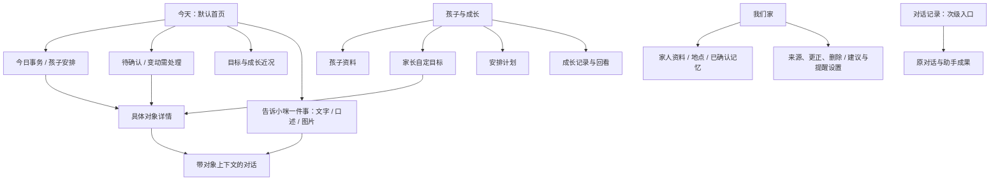

# 小咪育儿核心：产品与交互合同

日期：2026-10-23。源码审计基线：`4ec8118b796f7c983ae4436268441c3c9d3d33db`，本地分支 `feat/parenting-core`。本文是恢复育儿核心的设计依据，不是功能上线或真实设备验收记录；交付进度仍只在[主计划](../../status/master-plan.md)维护。

本次用户最新要求覆盖此前的默认聊天方向，以及[定位 v1](positioning-v1.md)中“成长陪伴为第二层、不放一级位置”的取舍。产品从**宝妈带孩子与长期成长**出发，随后扩展家庭事务和自我管理。今日安排与长期成长必须共同构成核心，不能再次收敛成通用聊天 Agent，也不能只剩到点提醒。

保留 `ba560b9` 的 `mimi` / `小咪` 品牌结果、暖白与橙色猫图标、现有安装和数据身份；不修改[内部标识](../../internal-identifiers.md)、冻结协议身份或历史验收。本文不修改网站，也不以旧暂停记录抵消本次已明确授权的本地工作。旧文件的日期证据保留，涉及当前方向冲突时按本文与用户最新要求解释。

**本轮选定 MVP 是账号隔离、加密的本机育儿账本。**默认今天，提供孩子与成长、轻目标、单次安排草稿/确认/调整/取消、家长完成记录与观察回看；文字整理在安排表单原位请求、等待和核对，全局辅助聊天保留手动入口且不自动带入原话。家庭云 API 暂不接入：现有开关未开放，且缺目标/完成合同与图片提取接线。原位 AI 使用独立的受限提取 namespace，不是启用家庭云 API。本机保存明确显示“保存在本机，尚未同步；未设置系统提醒”，不显示家庭云同步、通知或图片提取成功。下文完整产品合同与后续路线不代表本轮全部实施。

“本机账本未同步”不表示所有 AI 交互都在设备内。家长点击“让小咪整理”后，本次已展示的原话与当前时间、时区经现有账号、模型路线和许可流程发送；孩子与目标 ID 由本机冻结绑定，不自动附上家庭档案或历史对话。请求未得到明确触发前不发送，原位结果也不自动写入账本。

## 1. 产品承诺与边界

**接住孩子每天的安排，留下成长中的点滴，让妈妈能放心回看、继续调整。**

家长打开小咪，先知道今天要处理什么、孩子有什么安排、最近在陪伴什么目标、有哪些值得留下的小变化。文字、口述和图片帮助整理这些具体事情；家长不必先学习如何给 Agent 下任务，也不必每次从聊天历史里找事实。

首期用一位照护者管理自己填写的孩子资料。昵称即可开始；学校、班级、年龄段、常去地点按实际需要选填，不强迫提交生日、真实姓名、健康信息或完整家庭关系。多孩子使用同一套对象和筛选方式，不用复制整套界面。第二位照护者、家庭共享和个人自我管理留有权限边界，能力未开放时不展示邀请或共享成功。

温馨体现在能听懂对象、保留草稿、接受纠正、清楚说明未知和克制跟进。猫图标不代替执行回执，也不以亲昵措辞淡化失败。不给孩子贴“落后”“不自律”等稳定标签，不设置能力分数、排行榜、连续打卡惩罚或家长 KPI。教育和医疗内容不作为自动决策依据；不生成诊断、治疗、择校结论或替家长安排训练强度。

## 2. 当前真实路径与定位错位

下表审计的是维护源，不把历史页面、接口文档或测试夹具当成已接入功能。

| 真实路径 | 当前行为 / 错位 | 本次设计裁决 |
|---|---|---|
| [`App/catApp.swift`](../../../apps/ios-conversation/Sources/App/catApp.swift)，`chatSurface`、`accountChat`、`primaryView` | 已认证账号和启动壳直接展示 `ConversationFirstView`，真正默认首页是聊天 | 在同一账号组合点接育儿首页；保持同一个 App、认证门和账号生命周期 |
| [`Features/RootView.swift`](../../../apps/ios-conversation/Sources/Features/RootView.swift)，`BriefView` 与 `SidebarView` | 旧 `AppModel` 的“个人助理”，含环境、专家、技能、项目；不是当前 `catApp` 的首页入口 | 不能只修改这个文件宣称已重定位，也不能把它恢复成第二个宿主 |
| [`Features/ConversationFirstView.swift`](../../../apps/ios-conversation/Sources/Features/ConversationFirstView.swift)，`baseSidebarSnapshot`、`route`、`navigationDestination` | 以对话为根，主要入口是待办、助手成果记录、记忆、设置；没有孩子和成长主导航 | 育儿对象成为主导航，聊天作为处理具体事情的工具；历史对话仍可回到原处 |
| [`Domain/ConversationStarterPrompts.swift`](../../../apps/ios-conversation/Sources/Domain/ConversationStarterPrompts.swift) | 客户回电、评审会、办公咖啡馆、上线清单、周报等通用工作示例 | 从育儿首页移除这些推荐，换成“整理通知”“改孩子安排”“记一件成长小事”；不自动发送含虚构信息的整段 prompt |
| [`Domain/ConversationSessionContracts.swift`](../../../apps/ios-conversation/Sources/Domain/ConversationSessionContracts.swift)，`ConversationGoalProjection`；[`ConversationTaskPlanContracts.swift`](../../../apps/ios-conversation/Sources/Domain/ConversationTaskPlanContracts.swift) | Goal 绑定 run/task；计划步骤固定为 `compose/save/verify`，表示助手工作 | 与家长自定成长目标、孩子安排计划分别建模；助手完成报告不表示孩子做过 |
| [`Features/ConversationFirstView.swift`](../../../apps/ios-conversation/Sources/Features/ConversationFirstView.swift)，`.results`；[`ConversationInboxView.swift`](../../../apps/ios-conversation/Sources/Features/ConversationInboxView.swift) | “记录”主要是助手成果和工作回执 | 成长记录使用独立观察/事实时间线，报告仅作为可引用材料 |
| [`Features/Memory/MemoryLibraryView.swift`](../../../apps/ios-conversation/Sources/Features/Memory/MemoryLibraryView.swift)；[`ConversationMemoryView.swift`](../../../apps/ios-conversation/Sources/Features/ConversationMemoryView.swift) | 来源、记录时间、候选确认、更正、忘记、关闭已有基础；主列表较轻，完整核对在二级入口；范围仍称“工作区对话” | 复用控制机制，提升孩子归属、来源和时间的可见性；不只给旧记忆页换标题 |
| [`Features/Proactive/ProactiveWhySheet.swift`](../../../apps/ios-conversation/Sources/Features/Proactive/ProactiveWhySheet.swift) 与 [`ProactiveSuggestionCard.swift`](../../../apps/ios-conversation/Sources/Features/Proactive/ProactiveSuggestionCard.swift) | 已有原因、信号、记忆引用、稍后、不用了；仍偏会议与参会人语义 | 建议绑定孩子/事项，保留解释与拒绝控制，补上同类建议关闭入口 |
| [`Features/Composer/ComposerAttachPopoverView.swift`](../../../apps/ios-conversation/Sources/Features/Composer/ComposerAttachPopoverView.swift) 等 | 已有照片、相机、文件与听写输入基础 | 复用输入外壳；附件可选不代表所有格式都已有识别、提取、保存闭环 |
| [家庭 README](README.md)、[技术方案](../../architecture/family-companion-technical-plan.md)、[执行 Goal](execution-goal.md) | 仍要求 conversation-first、聊聊默认；[定位 v1](positioning-v1.md)又将成长降为第二层 | 这两项产品取舍被本次要求覆盖；既有来源、权限、幂等与未知结果约束继续保留 |
| [家庭 API v1](api-v1.md) | 已有 plan/item/observation/memory 等合同；缺独立成长目标对象和家长记录实际完成的命令，`item.status` 没有 completed | 新 UI 不挪用 Agent Goal，也不把 `scheduled`、时间已过或模型回复映射为完成；补合同与持久化后才开放相应生效动作 |
| [`design-tokens.json`](../design-tokens.json) 与[当前原生 token](../../../apps/ios-conversation/Sources/DesignSystem/catBrandTokens.swift) | 通用 JSON 留有旧灰蓝值，和当前暖白橙原生语义不一致 | 本轮使用原生 `catBrandTokens`、`Components` 和品牌规范，不从旧 JSON 或概念图反推新主题 |

在上述审计基线中，维护源没有完整的孩子档案、育儿目标、家庭安排与成长时间线原生视图/应用服务；`ConversationObservation` 等网络观察类型也不等于孩子成长观察。已有后端 family 模块和冻结合同的存在，不能证明它们已经接入当前原生用户旅程。本轮新增本机对象不改变这一基线审计的时间归属。

## 3. 保留、移除、降级与重做

| 处置 | 内容 | 结果 |
|---|---|---|
| **保留** | 现有橙猫图标、暖白主题、语义字体、Dynamic Type、侧栏手势、原生返回、草稿恢复、单一账号门 | 降低迁移成本，保留小咪身份和已有数据 |
| **保留** | typed service 边界、稳定对象 ID/revision、来源、回执、冲突、unknown 核对、账号切换围栏 | 新页面不拥有第二套事实或执行状态机 |
| **保留** | 文字、现有听写、照片输入、可读卡片与普通轻回答 | 交流方式继续自然，结果落到具体对象 |
| **移除首屏** | 通用办公推荐、无对象的“拆解任务/起草周报”、专家/技能/项目入口、模型能力陈列 | 第一次打开就能理解这是帮助带孩子与记录成长的产品；历史源文件不因此删除 |
| **移除** | 未确认就说“已安排”、模型推断变稳定事实、已提醒等于已办、完成率推断成长 | 页面文字和事实严格对应 |
| **降级** | 聊天首页、新对话主动作、独立通用报告/Agent 成果中心 | 聊天从事项/孩子/目标详情进入；通用能力保留在对话历史或必要的次级入口 |
| **降级** | 模型路由、环境与开发能力设置 | 保留合适的开发/高级设置；不占据家长日常任务流 |
| **重做** | 默认首页、侧栏顺序、空态、快捷动作、提醒汇总 | 以今天、孩子和成长为组织对象 |
| **重做** | 家长目标/安排计划/实际发生/完成记录/建议的 UI 语言和关联 | 每一种都有自己的来源、生命周期和动作 |
| **重做** | 记忆详情、成长回看、计划调整、建议原因页 | 家长能看到小咪依据什么、理解是否过期，并能直接纠正或关闭 |

“移除首屏”是产品入口取舍，不是删除历史数据或破坏已有兼容路径。旧对话、成果和深链仍通过原身份访问；没有权限时显示不可见，不泄露标题或孩子信息。

## 4. 信息架构与默认首页

**默认根页面为“今天”**，孩子与成长、记录为并列内容。导航可以复用现有侧栏或使用简洁的内容切换，不由历史方案锁死；保留原生返回和辅助聊天里的既有侧栏。账号和设置继续在低干扰位置。聊天不再占据默认根页面或与育儿内容竞争的第一主动作。

“孩子与成长”是首期一级内容；“我们家”先承载家长自己维护的家庭资料和控制，不暗示多照护者共享已经开放。家庭事务、自我管理后续接入同一导航和权限体系，首屏不摆空模块。

本轮原生使用“今天 / 孩子与成长 / 记录”的轻量底部内容导航；安排文字整理留在表单原位，普通聊天作为辅助 sheet。“我们家”完整资料、云记忆与多照护者属于后续内容，不为凑齐架构摆空页面。上图表达产品内容关系，不要求另建导航包或 App shell。“记录”在本轮育儿根页面指家长观察/完成记录，辅助聊天里的旧助手成果仍按原身份访问。

### 今天页的顺序

1. **日期与孩子范围**：显示当地日期、今天/相邻日期切换、全部孩子或具体孩子。家庭时区明确可查看；“全部”只聚合当前账号有权看到的资料。
2. **待你确认**：仅有未确认或变更冲突时出现。显示对象、来源、缺项和动作；它与已确认日程分区，不混在时间轴中。折叠后保留明确数量，不用红色制造虚假紧急感。
3. **今日事务与孩子安排**：按时间与截止显示“几点、哪个孩子、什么事、地点/需带物品”。无时刻的准备事项独立显示；日期未知的内容继续留待确认。能直接打开详情、改安排；有真实完成合同后，才允许记录做过/跳过。
4. **目标与成长近况**：一条家长正在陪伴的目标、最近一次观察，提供“记一件小事”和“看看成长记录”。这里不是连续打卡栏，也不因今天没有新记录提示落后。
5. **可解释的建议**：仅在有相关依据和具体可选动作时出现；原因、来源、稍后、不再建议可触达。没有内容时不占空卡。

页底保留低干扰输入“告诉小咪一件事”。点入后仍能看到“给谁 / 处理哪件事”的上下文，且可修改。键盘收起后回到原位置。普通查看、修改字段、确认和记录观察均可通过原生控件完成；不用先发一轮聊天才能访问自己的信息。

空态首先允许“添加孩子昵称”“加一个安排”“记一件小事”。可跳过资料补全。示例带“示例”标识且不混入真实列表；不以办公 prompt 填满首页，不把演示数据保存为该家庭事实。加载、离线和无数据是不同状态。

### 孩子与成长页

孩子摘要只显示已填写资料、家长自定目标、计划和成长记录。目标描述“我们希望一起尝试什么”，不评价孩子能力。目标详情可看关联计划、按时间排列的观察和家长复盘；修改目标不改写此前事实。成长时间线以发生时间排列，同时保留记录时间；晚记、补记和更正均明确标注。

成长回看回答“有哪些被记录的变化、依据在哪、还有什么不知道”。单次观察不外推趋势；记录不足时直接说明。周/月小结必须可回到原记录，属于可编辑的总结，不自动升级为孩子事实或新的目标。敏感内容默认私有，不因将来加入家庭成员而公开。

## 5. 五类核心对象与完成语义

| 对象 | 家长理解 | 最少内容 | 允许的变更 / 完成含义 |
|---|---|---|---|
| **目标** | 我想陪孩子往哪个方向尝试 | 孩子、家长原话、可选时间范围、创建来源、版本 | 草稿→进行中→暂停/结束；结束可为调整方向，不强制等于达标；不自动生成分数 |
| **计划** | 准备怎么安排 | 孩子、可选目标、节律或时间范围、复看时间、来源、版本 | 草稿→生效→暂停/结束/归档；暂停计划不偷偷取消已确认事项；改系列和改单次要区分 |
| **安排事项** | 哪一天做哪件事、要准备什么 | 孩子、标题、日期/时刻或截止、需带物品、来源、确认回执 | 未确认→已安排→改期/取消；“已安排”只证明保存安排，不能证明实际发生 |
| **发生事实 / 成长观察** | 家长记录实际看见或听见了什么 | 孩子、原话、发生时间、记录时间、记录人/来源、版本 | 已记录→更正/删除；保留“家长描述”语义；模型总结与家长原话分层 |
| **完成记录** | 这一次实际做过、跳过，或取消了 | 关联事项可选、家长决定、实际时间、说明可选、记录来源 | 独立事实，可纠正/撤回；模型答完、推送送达、日历写入、时间已过都不能生成“做过” |

**建议**是跨对象的提案层：未采纳→稍后/拒绝/过期，或采纳后形成待确认的对象变更。点击“采纳”不能一次性把“计划已生效”“日历已添加”“孩子已完成”三个状态一起染成成功。

不要把以下词混用：

- “已整理”：只表示小咪提取出可核对内容。
- “已保存安排”：存在对应对象的成功回执；还没有证明系统日历或通知成功。
- “已加入日历 / 提醒已设置”：分别有对应系统效果的真实回执。
- “已记录做过”：家长确认的一次实际发生记录。
- “已记录观察”：一条观察已保存，不等于稳定长期记忆。
- “小咪记住了”：已确认记忆写入且可查看来源与范围。

现行家庭 API 缺目标和实际完成命令。未来接云时须在版本化合同内明确扩展及兼容策略；本设计没有把新状态偷塞进已有 `item.status`，也没有更名 `catpaw.family.v1`。能力不足时隐藏会产生假成功的写动作，解释具体不可用项并保留草稿；不能用空目标入口或仅有聊天气泡宣称育儿闭环完成。

本轮本机合同由 [`ParentingWorkspace.swift`](../../../apps/ios-conversation/Sources/Domain/ParentingWorkspace.swift) 与 [`ParentingWorkspaceStore.swift`](../../../apps/ios-conversation/Sources/Persistence/ParentingWorkspaceStore.swift)承载。`ParentingGoal` 与 Agent Goal 分开；`ParentingArrangement` 是关联 `childID/goalID` 的单次安排，使用 `draft/planned/cancelled/completed`；`ParentingRecord` 区分 observation/completion。完成安排必须原子写入 completed 与家长完成记录。此处状态属于本机领域，不是改写家庭云协议。

本轮尚未单独实现周期计划、目标暂停/结束、计划复盘或跨设备历史。不要把轻目标的增加/删除称为完整目标生命周期，也不要把一条单次安排称为周期计划。原始 `sourceText`、创建时间、更正时间支持本机追溯；它们不等于老师认证的来源、已验证的媒体提取，或跨会话长期模型记忆。独立发生时间、模糊日期澄清等能力以最终合同为准；未具备时只能准确称为按记录时间回看。

## 6. 三条目标旅程与本轮落点

### 通知 / 口述 → 可确认安排 → 今天

家长从今天页选择孩子，发一张课程通知或说“游泳课改到周五五点”。小咪先提取标题、孩子、日期、时刻、地点、需带物品和来源。缺具体日期、上午/下午或孩子归属时，只问影响结果的缺项；不要根据当前日期、照片上下文或默认孩子静默猜定。

确认卡展示完整日期和时区、原安排与变动、单次/整系列、受影响提醒。家长可直接改字段；“确认保存安排”提交同一命令并显示待处理。成功回执后才进入今天的已安排分区。请求超时则标“结果待核对”，只读原命令结果，不创建另一条相同安排。

图片只是这条旅程的一种来源；相机/照片入口存在不代表识别已可用。模型/附件处理不可用时，可转为手填草稿并保留原文，不能生成虚构提取结果。首期不读取家长群、老师私聊或第三方账号，除非家长明确提供材料并有对应能力。

**本轮落点**：家长补齐名称和明确时间、点击“保存为待确认”后才形成 durable draft，之后仍需明确确认；未保存表单与未补时间的原话尚未持久化。调整和取消仅改本机账本，不更新系统日历、通知或云端。手填与 AI 候选分别标明来源，不称“小咪已经识别通知”。

### 自定轻目标 → 计划 → 一次发生记录

家长在孩子页写“希望多一些一起阅读的时间”，可选择只记目标，或自己添加一周内的一次共读安排。小咪可帮助整理措辞、问何时合适，不自动生成训练表、强度和达标率。家长确认后，目标、计划和一次安排各有独立身份。

当家长选择“这次做过”时，可顺手补一句“今天他主动选了故事”。完成记录只说明这一次发生过；这句话作为成长观察独立保存、可编辑，不被模型转换成“孩子已经养成阅读习惯”。之后调整目标或计划不抹去原观察。

**本轮落点**：轻目标可关联单次安排、家长完成记录与观察，按同一 `goalID` 回看；没有自动训练表、周期安排或达标率。完成写入是本机原子变更，成功只说明该本机账本保存，不表示云同步或系统效果。

### 成长观察 → 回看 / 更正 / 删除

家长说“记一下，今天自己收好书包了”。卡片先显示孩子、原话与发生日期，让家长确认保存观察。保存观察与“允许用于长期记忆”是两种决定；普通观察不默认变成稳定事实。“小咪的总结”如需保留，明确标记并连接原记录。

在孩子时间线和相关记忆详情都可看到来源、发生/记录时间、使用范围与更正/删除。改错孩子、改发生日期或删除后，首页、时间线、后续总结和建议同步遵守最新版本；迟到结果不让删掉的内容重新出现。删除原始照片、删除观察、忘记记忆、删除对话的范围分别解释，不能用“删掉了”一句话混过。

**本轮落点**：保存家长原始输入、记录时间与更正内容；成长观察可更正/删除，目标关联用于本机回看。云记忆与对话历史保持各自范围，不承诺一起删除或自动学会。观察的“发生日期”与“记录日期”若最终代码没有分开，应列为后续缺口，不根据家长一句“昨天”伪造已经支持补记。

## 7. 通用状态与可靠交互

| 状态 | 页面表达 | 可做动作 / 边界 |
|---|---|---|
| 首次使用 / 无孩子 | 说明添加昵称即可开始 | 可跳过选填资料，不填充假孩子 |
| 加载中 | 只在相应区块显示读取状态 | 不用空态覆盖仍在加载的事实 |
| 已缓存 / 离线 | 展示“上次更新”与本机保存状态 | 可看缓存和改草稿；未同步不说云端已保存 |
| 草稿 / 需澄清 | “还缺日期”“尚未确认” | 可改字段、补充原话、取消；不进入正式日程 |
| 待确认 | 展示完整对象与将发生的变更 | 主动作明确为确认此次保存/变更 |
| 提交中 / 已受理 | 作用域内显示进度 | 不重复点击或生成新命令；允许离开后恢复 |
| 已生效 | 命令回执与对象最新版本一致 | 只对已证实的那一步显示成功 |
| 结果未知 | “结果待核对，草稿保留” | 读取原操作；不盲目重发、补建或自动撤回 |
| 版本冲突 | 对比自己草稿与最新版本 | 保留草稿，重新核对后再提交，不静默覆盖 |
| 拒绝 / 能力不可用 | 具体原因与当前仍可做的事 | 不假装模型、识图、家庭 API 或系统权限可用 |
| 已取消 / 已删除 / 权限撤回 | 从可行动列表移除，详情说明当前状态 | 墓碑优先于迟到同步；旧建议和提醒失效 |

切换孩子不改变已发请求的归属；发送时冻结孩子/家庭/事项上下文。切换账号沿用既有 account epoch，旧异步结果不能落入新账号。所有入口展示同一对象版本；视图、聊天流和卡片不自行拥有第二套完成状态。

本机 MVP 的成功边界是加密本机存储提交后的对象版本，不等待不存在的云回执，也不把它画成“待云同步队列”承诺稍后必然上传。进程结束后重开可恢复已提交草稿；保存失败保留可恢复原内容并显示失败。未完成的 AI 请求和本机已保存草稿是两件事。

## 8. 记忆与主动建议

记忆详情首屏至少显示：关于谁、内容种类、原始来源或可读摘要、发生时间与记录时间、适用/有效范围、是否已确认、上次更正，以及“更正 / 忘记”。事实、偏好、观察摘要、模型推断不得在列表里混称“了解孩子”；未知和冲突要保持可见。来源已到期或删除时明确说明，不放失效的媒体按钮。

保存一次观察不自动开启长期记忆。关闭记忆利用、停止自动保存、忘记某条、删除原记录是独立控制，说明影响范围。忘记后不允许模型从旧来源悄悄学回；重新学习需要新的明确决定。主列表与高级核对页不能出现互相矛盾的有效状态。

建议卡回答四件事：“针对哪件事”“为什么现在出现”“依据哪些记录”“这次会改变什么”。可展开来源，支持稍后、这条不用、关闭此类/全部建议。依据不足、来源过期或记忆关闭时不引用旧结论。家长关闭建议后，不能换文案或换入口继续催促。

采纳建议只进入明确的变更核对；小咪不自动安排课程、改日程、报名、缴费、购买或向第三人发消息。本轮不借重定位新增后台推送额度、静默时段或自动保存授权；沿用可验证的现有选择，未知策略保持关闭。系统提醒和小咪建议分开管理，关闭建议不偷偷删除家长已确认的提醒。

## 9. 本轮最小闭环与分阶段路线

以下保留本轮切片的能力边界；用户后续要求逐个继续，具体顺序以[M1–M6证据化差距与依赖](parenting-milestones.md)为准，实时状态在master-plan。全部继续使用唯一原生宿主和既有资源，不引入新服务、依赖、凭证或计算预算；路线本身不授予部署、生产或试用招募权限。

| 切片 | 具体交付 | 阶段边界 |
|---|---|---|
| **本轮：本机育儿最小闭环** | 默认今天；账号隔离加密账本；孩子昵称、家长自定轻目标；原位文字整理→显式采用可编辑字段→保存待确认草稿→确认；单次安排调整/取消→原子完成与家长完成记录；按孩子/goalID 回看观察、原话、时间及更正/删除 | 原位 UI、独立加密请求日志、受限提取服务源码已接线；新后端未部署，原生 SDK/UI 与真实模型仍未运行。无家庭云同步、图片提取或系统提醒；不称真实 AI 闭环已验收 |
| **下一片：同版真实验证与云合同** | 验证原位许可、真实模型候选、缺项/时间语义与故障恢复；补独立发生时间；云目标/完成等合同按版本补齐后，再接能力探测、同步与冲突 | 不绕开 flag 或用 mock 证明云可用；旧服务 404/405 应诚实失败，保留手工填写；模型与原生验证分别留证 |
| **随后：多模态与长期回看** | 图片/现有听写的实际提取；周期计划与单次变动；基于来源的周/月回看、目标调整、可关闭建议；明确确认后设置相关提醒 | 图片/语音分别验收；不自动诊断、评分或执行调整。模型、PG、系统提醒与长期使用均需各自证据 |
| **再后：家庭与自我管理** | 经单独确认开放第二位照护者、对象级共享、成人自己的目标/记录 | 家庭资料、孩子记录、成人私聊与私人自我管理不互相自动共享 |

本轮以**文字和手工核对作为可靠基线**，保留 AI 接续的实际差距。最少验证“选孩子 → 自定轻目标 → 原话成为持久草稿 → 确认 → 今天看到 → 家长记录做过与观察 → 按目标回看 → 更正/删除”。这说明本机对象闭环成立；只有模型真实输出能安全回到对应草稿，才另称自然语言 AI 接续。多模态随后接入同一对象和状态，不另造图片任务系统。

如果本轮只完成导航与静态页面，应准确称为“育儿核心原生界面切片”；如果只完成后端合同，应称为“育儿领域合同切片”。两者都不能单独算上表最小闭环。

## 10. 验收观察点

验收使用虚构孩子和材料；真实账号、模型、数据库、通知与设备操作按具体候选授权执行。本设计的静态审查、离线测试、夹具截图、真实系统效果分别留证，互不替代。

- **定位**：冷启动的实际认证后入口是今天；首屏能看到今日安排和成长入口，通用办公推荐不出现。不能只测试旧 `RootView`。
- **不用聊天也能完成**：查看孩子安排、改字段、确认、记录观察和来源更正可由原生控件完成；聊天继续服务这些动作。
- **目标 / 计划 / 事实 / 完成**：四者身份与状态可分别读取；完成助手工作、提醒送达和安排过期都不自动增加孩子完成记录。
- **两种保存**：保存观察不自动产生已确认长期记忆；选择长期保存时能看到对象、范围、来源与回执。
- **安排可靠**：缺日期/孩子时不猜；未确认不进日程；超时只核对原命令；改期、取消、重复点击不产生重复安排或复活提醒。
- **纠正与删除**：同一对象在今天、孩子时间线、记忆和建议中使用最新版本；删除后迟到结果不得恢复；删除范围如实说明。
- **跨上下文**：快速切换孩子、退出/换账号时，原草稿与异步结果不归错对象，不泄露旧标题。
- **建议可控**：能看到为什么、所用来源、稍后和关闭；关闭后相关建议不换入口继续出现，采纳前无实际副作用。
- **视觉与可用性**：浅/深色、长中文、系统大字号、屏幕阅读顺序、单手触控和键盘恢复保留；文本完整换行，关键状态不只靠颜色或猫表情。
- **成长质量**：观察与总结可回到家长原话；无儿童能力评分、焦虑催促或医学/教育决策冒充事实。真实家庭连续使用前不声称长期理解已经有效。

## 11. 视觉基准

使用 [`catBrandTokens.swift`](../../../apps/ios-conversation/Sources/DesignSystem/catBrandTokens.swift)、[`Components.swift`](../../../apps/ios-conversation/Sources/DesignSystem/Components.swift)、[`AdaptiveTextLayout.swift`](../../../apps/ios-conversation/Sources/DesignSystem/AdaptiveTextLayout.swift)和[品牌规范](../../brand-theme.md)。保留已有选定猫图标与兼容身份，不重做品牌。

| 角色 | 当前原生值 / 规则 |
|---|---|
| 奶油暖白背景 / 深色画布 | `#FFFCF8` / `#0E0C0A` |
| 正文 | `#292622` / `#F2F0ED`；长文保持中性 |
| 品牌橙 | `#FF702A`；猫、品牌与装饰身份 |
| 可读操作橙 | `#C64A0B` 浅色；复用语义映射，不用亮橙作小字 |
| 发送 | 继续使用 `catColors.send` 的 `#3567EE`，与确认和品牌身份区分 |
| 卡片 / 本人气泡 | 现有白色内容卡 / 中性浅色气泡，不把每段回答卡片化 |
| 布局 | 页边 20、区块 28、行距 12、卡片圆角 20、控件圆角 14、最小触控 44pt、可读宽度 680 |
| 字体与图标 | 系统语义字体、Dynamic Type、SF Symbols 语义符号；图标随字体缩放 |

温馨图标用于区分日程、准备、观察、目标和来源；状态始终有文字。只有实际收音才显示“正在听”，只有相应真实回执才显示成功。动效轻且可打断，遵守 Reduce Motion；不播放持续庆祝、不用动画催促记录或完成。

## 12. 产品价值评审：怎样少做事，AI 接到哪里

本机持久化、目标关联与完成记录解决了“聊天说过却找不回来”和“每次重填背景”的一部分问题，但如果家长仍要逐项填写标题、日期、时间、孩子、目标，再把聊天答案复制回来，产品价值仍接近日历加表单。首页重定位本身不能证明 AI 帮家长接住了事情。

### 原位整理的实际接线与边界

原位实现已落盘：[`ParentingInlineIntakeModel.swift`](../../../apps/ios-conversation/Sources/Features/Parenting/ParentingInlineIntakeModel.swift)在表单内持有独立 conversation ID、operation ID 与 `ConversationSessionService`；[`NativeParentingIntakeComposition.swift`](../../../apps/ios-conversation/Sources/Providers/NativeParentingIntakeComposition.swift)从现有认证组合点注入 configuration/credentials，沿用已选模型、来源授权与配额。独立的 [`ParentingIntakePersistence.swift`](../../../apps/ios-conversation/Sources/Persistence/ParentingIntakePersistence.swift)以账号隔离加密快照保存请求 journal，不把原话写进主聊天 Repository，也不依赖共享聊天的当前会话或发送队列。

服务端新增 `/catpaw/parenting-intake/v1` namespace，合同仍为 `mimi.parenting-intake.v1`；[`parenting-intake.mjs`](../../../services/edge/supabase/functions/_shared/core/src/parenting-intake.mjs)与 [`chat-service.mjs`](../../../services/edge/supabase/functions/_shared/core/src/chat-service.mjs)将 intake mode 冻结在 conversation/turn。该模式工具集合为空，拒绝图片、任意 context、UI/device/approval 等能力，关闭记忆召回/提取/写入、主动建议与工作执行接线，并拒绝模型工具调用。隔离来自运行时合同和分支，已超出此前仅在 prompt 中要求“不调用工具”的过渡桥；不改变普通聊天的能力。

1. 家长选择本机孩子/可选目标、写原话，点击“让小咪整理”才发起本次请求，原位显示准备与等待。发送内容为可查看的原话、当前时间和时区，最多 3000 字；不附家庭档案或历史聊天。需要模型发送许可时在当前流程呈现既有许可，未允许前不发送原话。
2. 原位状态包括待许可、发送中、失败、结果未知、已取消和候选可核对。未发送失败可重试原请求；已确定失败后家长可明确发起新一次，受理/发送结果未知时仅读取原 ID，不换 ID 重发。取消/离开页面/修改原话或选择会使本次候选失效，停止本机等待并尝试清理独立临时材料；不宣称已撤回供应商收到的请求。
3. [`ParentingIntakeDraft.swift`](../../../apps/ios-conversation/Sources/Domain/ParentingIntakeDraft.swift)只接受本次精确 prompt/nonce、账号代次、conversation/turn 与最终 `assistantMessageID` 对应的完整严格 JSON；不读“最新一条助手回复”。服务端另校验候选合同与字段。格式、来源或绑定不符就保留原话并显示失败，不自动回退到普通聊天发送。
4. 候选先以“尚未采用或保存”预览。家长点击“采用整理结果”才替换可编辑名称/时间，继续核对并保存为待确认草稿，再单独确认安排。缺日期/明确钟点保持未定；时间证据只验证原话引用与结构，不能证明模型的日期计算或上午/下午理解正确，仍需家长核对。
5. 原位请求 journal 与已保存安排草稿是不同数据。“恢复上次整理”由家长显式触发，只读取原请求；带回前说明会替换当前原话和孩子/目标选择，候选仍须明确采用。关联已删除时要求重新选择，不能猜配；没有自动冷启重发。未请求或未保存的普通表单内容不能因此宣称可冷启恢复。新 namespace 未部署时，404/405 显示服务版本尚不支持的失败，原话仍可手工填写，不能切回普通聊天冒充受限提取成功。

[`ParentingHomeView.swift`](../../../apps/ios-conversation/Sources/Features/Parenting/ParentingHomeView.swift)已接原位请求、许可、等待、失败/重试、unknown 读取、停止与显式采用；不再要求先切聊天页完成主流程。表单旧“其他方式”普通聊天提示/回填桥与源码/项目引用已移除，避免向主聊天再复制一份原话；仅保留不自动带入原话的全局辅助聊天手动入口。提取服务不可用时继续手工填写，不自动切普通聊天。已有 CGUI 与规则 `family/extract-text.mjs` 均不是本次提取权威。

以上是源码接线事实；本轮新后端未部署，真实模型与原生 SwiftUI/系统 SDK 验证仍为 `NOT_RUN`。HTTP mock/严格 parser 的离线结果只证明相应受检逻辑，不证明真实模型能稳定整理、页面可用性或端到端成功。

### 提取材料保留与删除

加密保护内容，最小化则限制复制、用途和保留时间。发送前明确说明现有已选 AI 服务、仅原话与时间/时区、不自动附家庭档案；候选采用不等于同意长期保存提取日志。

| 位置 | 实际保存内容 | 保留与清理边界 |
|---|---|---|
| **本机临时材料** | 账号隔离的 `journal.sealed`：本次请求/回复和状态；`recovery.sealed`：原 ID、孩子/目标绑定、原话、开始时间及时区等恢复信息。两者均为独立加密临时副本，不进入主聊天库 | 恢复上限 24 小时；打开/恢复时检查过期并清理，不承诺后台准时物理删除。采用、取消、修改输入/归属或删除本次整理时清理这两份材料；静态 Repository 缓存使用弱引用，不长期保留已释放请求的明文快照 |
| **本机清理队列** | `cleanup.sealed` 仅含 scope、subject、conversation ID 与待清理标志，不含原话、prompt 或模型输出 | 远端清理未确认时保留以重试；UI 明示清理未完并阻止新整理。清理成功后移除引用；不把本机删文件显示为远端删除已成功 |
| **服务端必要记录** | 既有 conversation/turn 表仅保存身份、权限/版本、请求/原文哈希、去内容的事件元信息；不持久化 intake 原话、模型回复、user/assistant 消息或 model history | 同 scope/subject/purpose 的专用 DELETE 在同事务撤权并提升 grant fence，清空内容字段与事件，保留身份/哈希墓碑供幂等核对；旧结果不能再次写回 |
| **服务端短时内存** | 执行所需原话 prompt、回复/思考文本的事件 buffer；无新增内容日志、服务或清理 cron | 缓存最多 15 分钟，访问时检查过期并配合计时清理；完成后释放不再需要的输入。进程重启/过期使内容不可恢复，读回返回 `parenting_intake_content_unavailable`，不得据此再次调用模型。DELETE 同时清受控缓存并 abort 本实例执行 |

表单仍在编辑的原话与家长显式保存到安排的 `sourceText` 不属于待清理提取副本，按各自显示的保存/删除动作处理。删除失败或离线时保留“不含原话的清理引用”，不声称所有远端材料已清；服务端 DELETE 也不证明第三方模型供应商已经撤回或删除收到的内容。上述本机清理/恢复仍需原生验证，服务端离线测试不替代同版部署验证。

### 三个高频场景的省力程度

| 场景 | 妈妈可少做什么 | 本轮实际可交付 / 仍有成本 |
|---|---|---|
| **首次交代**：“明天下午四点半带团团去游泳，想慢慢喜欢运动” | 当前孩子和选定目标沿本地 ID 绑定；原位候选可减少标题/时间字段输入，不再先切聊天、手动找回复再回来 | 已实现原位请求→候选预览→显式采用→编辑/保存/确认接线；真实模型与 SwiftUI 效果未验，缺项仍由家长补齐。原话不等于目标自动新增，未选目标时不替她决定长期目标 |
| **临时调整**：“周五那次改到六点，其他不变” | 从原安排详情进入可沿用孩子、目标和原对象，避免重建安排与重复选择背景 | 本轮没有把原安排 ID、baseRevision 与有限差异作为模型协议，不能声称已理解“那次/其他不变”。原位整理若从编辑表单触发仍只是字段候选，家长必须核对替换内容；语义差异接续留待后续 |
| **回顾**：“最近围绕运动有哪些小变化？” | 按 `goalID` 自动汇集相关完成记录与观察，直接回到原话和时间，不从所有聊天重新搜或复述背景 | 本轮可提供关联回看；未接模型总结就不称 AI 趋势分析。后续只发送家长选定的有限记录，返回带来源引用的总结；记录不足时说明，不推断达标或健康状态 |

安排完成时直接继承孩子和 `goalID`，家长可只写一句备注；观察从目标详情创建时继承同样关联。关联由当前本机对象提供，不让模型重新猜姓名、目标或稳定 ID。这两处省输入不依赖模型在线，属于可靠的产品价值。

### 本轮如何描述才准确

达到本机完整旅程时，可称“今天和成长的本机账本闭环”。当前原位代码可称“已实现受限文字整理与原位候选采用接线，原生/真实模型待验证”，不能称 `NOT_IMPLEMENTED`，也不能称真实 AI 闭环已经通过。只有同版服务和原生上的真实候选从自然语言整理回正确草稿后，才对该场景签收。图片通知、临时调整的指代、跨记录总结及长期理解分别验收，不借一次文字成功外推。

## 13. 未合入原生家庭候选的保留与接续

2026-10-23 本轮只读查验确认 [PR #120](https://github.com/Yankj/mimi/pull/120) 仍为 open、未合入 main；固定候选为 `e2703e5c28f9c27ca9dd729b2d632acda12c5d48`，本地只读引用 `origin/pr-120-audit`。该候选明确 unbuilt、未接默认 shell，不能当作设备或产品验收。审阅使用 `git show`，没有 checkout、导入、合并或改写其分支。因此“main 审计基线缺完整原生育儿功能”与“存在未合入家庭客户端候选”同时成立，不能写成没有任何原生家庭候选。

| 固定候选内容 | 可保留的价值 | 不能直接满足本轮的原因 |
|---|---|---|
| [`Domain/FamilyContracts.swift`](https://github.com/Yankj/mimi/blob/e2703e5c28f9c27ca9dd729b2d632acda12c5d48/apps/ios-conversation/Sources/Domain/FamilyContracts.swift) | `catpaw.family.v1` 的来源、revision、待确认卡与 projection wire 映射 | 没有独立成长目标、计划或完成事实模型；观察类型没有对应写入、更正删除的完整旅程 |
| [`Features/Family/FamilyStore.swift`](https://github.com/Yankj/mimi/blob/e2703e5c28f9c27ca9dd729b2d632acda12c5d48/apps/ios-conversation/Sources/Features/Family/FamilyStore.swift) | 一份服务端 projection 驱动今天/家庭，确认后刷新投影；不由点击把安排染成成功 | projection/lastCards/busyItem 为内存状态，没有账号 epoch、加密持久草稿或重启后的原命令核对日志；首次 load 无家庭时还会发 ensure，不能用作本轮纯本机默认入口 |
| [`Providers/FamilyHTTPBackend.swift`](https://github.com/Yankj/mimi/blob/e2703e5c28f9c27ca9dd729b2d632acda12c5d48/apps/ios-conversation/Sources/Providers/FamilyHTTPBackend.swift) | 复用既有凭据、固定命令 ID、丢响应先读 receipt 的方向 | 仍依赖已开放家庭 API；内存中一次核对不等于 durable unknown 恢复。启用前须核对协议字段/错误、能力与账号围栏；不是直接可用的本机持久层 |
| [`Providers/FamilyDemoBackend.swift`](https://github.com/Yankj/mimi/blob/e2703e5c28f9c27ca9dd729b2d632acda12c5d48/apps/ios-conversation/Sources/Providers/FamilyDemoBackend.swift) | DEBUG 标注示例，可保留作样式和受控反例输入 | 内存预置虚构孩子/过敏/提醒；文本截前 20 字并指定明天，图片直接转假通知，未实现命令的 default 仍回 applied。不能导入真实账本，更不能证明 AI、图片或写入完成 |
| [`FamilyRootView.swift`](https://github.com/Yankj/mimi/blob/e2703e5c28f9c27ca9dd729b2d632acda12c5d48/apps/ios-conversation/Sources/Features/Family/FamilyRootView.swift) 与候选 `ConversationFirstView` | 今天/我们家两个内容分区、DEBUG 示例入口 | 当前接线是聊天账号菜单的 DEBUG“我们家（示例数据）”→ demo backend；候选 `catApp` 默认仍聊天，不是本次育儿核心重定位 |
| `FamilyWarmStyle.swift`、Today/Confirm/Home/Capture 视图 | 复用原生颜色角色、文字与符号状态、需带物品、来源说明等局部布局 | 候选仍有 `cat` 展示文案，成长目标/完成/回看缺失；拍照按钮也不能证明真实 extractor。只作逐组件评审来源，不替换当前品牌或主页面 |

后续接续顺序：先补云目标/完成/观察及来源合同、能力 gate、账号上下文围栏与持久命令恢复，再选择 reviewed wire adapter 和局部组件；真实图片提取、未知结果、跨账号/家庭切换分别验收。不得把 `FamilyDemoBackend` 换个名字作为生产状态，或仅把 DEBUG 入口开放就称已接家庭云。

PR #120 与本轮都涉及 `App/catApp.swift`、`ConversationFirstView.swift`、`cat.xcodeproj/project.pbxproj` 以及资源/品牌文件。未来整合需单独对照当前 main 和本轮最终 SHA，逐文件选择字节；保留本轮默认今天与 `ba560b9` 品牌、既有 bundle/Keychain/存储/协议身份，不能整枝覆盖。项目成员和资源冲突由宿主集成负责人统一处理，不由组件直接导入另一入口或初始化自己的账号。

[PR #116](https://github.com/Yankj/mimi/pull/116) 的 roadmap draft 和 [PR #113](https://github.com/Yankj/mimi/pull/113) 的 cloud QA 保持独立规划/证据身份。本次没有将它们算入已合并源码、没有沿用其测试结果为本轮通过，也没有因本轮本机切片删除其未来接续价值。
